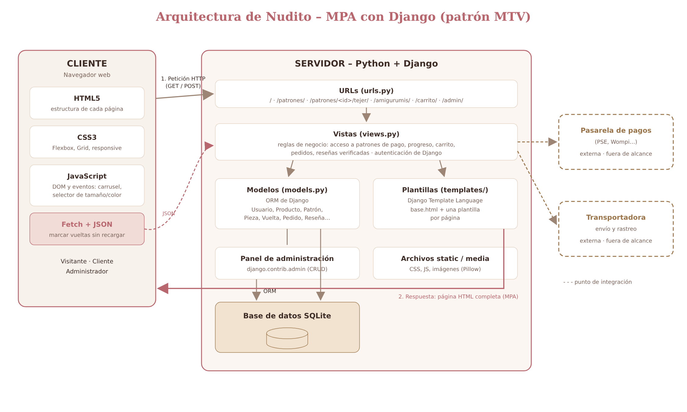

# Nudito – Tienda y patrones de amigurumis

Proyecto de **Programación en la Web (UIS, 2026-II, Grupo G2)**.

**Integrantes:** Alejandra Díaz Navarro (2240063)

Aplicación web **MPA** desarrollada con **Python + Django** donde los usuarios pueden comprar
patrones de amigurumi (gratuitos y de pago), amigurumis tejidos a mano e insumos, y llevar el
progreso de cada patrón vuelta a vuelta.

## Ramas del repositorio
| Rama | Contenido |
|---|---|
| `avance-1` | Entrega del avance 1: documento del avance (`docs/AvanceProyectoPWCrochet.pdf`) y Home en HTML, CSS y JavaScript |
| `entrega-final` | Proyecto completo en Django, documento del avance 1 actualizado con los cambios (`docs/AvanceProyecto_Nudito_Actualizado.pdf`) y documento de entrega final |
| `main` | Versión final del proyecto (igual a `entrega-final`) |



## Funcionalidades implementadas
- Carrusel de imágenes de novedades en la página principal (administrable).
- Búsqueda de patrones y productos por nombre.
- Filtros de patrones por nivel de dificultad, tipo de amigurumi y precio; orden por mejor valorados.
- Desbloqueo de patrones de pago después de comprarlos; los gratuitos se guardan en "Mis patrones".
- Sugerencia de materiales y kit completo para cada patrón.
- Seguimiento del progreso por piezas y vueltas (se guarda con Fetch sin recargar la página).
- Selector de tamaño y color que actualiza el precio del amigurumi.
- Carrito de compras (disponible también para visitantes; para confirmar el pedido se debe iniciar sesión).
- Pedidos con redirección a la pasarela de pagos y estados (Pendiente de pago → Pagado → En elaboración → Despachado). Los patrones de pago se desbloquean cuando el administrador confirma el pago.
- Calificaciones y reseñas verificadas (solo de lo adquirido) con promedio de estrellas.
- Registro, inicio de sesión y perfil de usuario.
- Panel de administración para gestionar productos, patrones (piezas y vueltas), kits, pedidos, reseñas y carrusel.

## Tecnologías
HTML5 · CSS3 · JavaScript (Fetch + JSON) · Python · Django · SQLite · Pillow · Git y GitHub · Penpot

## Cómo ejecutarlo
Requiere Python 3.10 o superior. En Windows se puede usar `py` en lugar de `python`.
```bash
# 1. Crear y activar un entorno virtual (opcional)
python -m venv venv
venv\Scripts\activate          # Windows
# source venv/bin/activate     # Mac / Linux

# 2. Instalar dependencias
pip install -r requirements.txt

# 3. Crear la base de datos (las migraciones ya están incluidas)
python manage.py migrate

# 4. Cargar datos de ejemplo (productos, patrones, carrusel y usuarios)
python manage.py cargar_datos

# 5. Ejecutar el servidor
python manage.py runserver
```
Abrir http://127.0.0.1:8000/

> Si el puerto 8000 está ocupado, usar `python manage.py runserver 8001` y abrir http://127.0.0.1:8001/

**Usuarios de prueba**
| Rol | Usuario | Contraseña |
|---|---|---|
| Administrador | `admin` | `admin123` |
| Cliente | `ana` | `nudito123` |

Panel de administración: http://127.0.0.1:8000/admin/

## Estructura
```
manage.py
nudito/            # configuración del proyecto (settings, urls)
tienda/            # aplicación principal
  models.py        # modelos (Usuario, Producto, Patrón, Pieza, Vuelta, Pedido, Reseña...)
  views.py         # vistas y reglas de negocio
  urls.py          # rutas
  admin.py         # panel de administración
  forms.py         # formularios (registro, perfil, reseñas)
  carrito.py       # carrito en la sesión
  management/commands/cargar_datos.py
templates/         # plantillas (Django Template Language)
static/            # CSS, JavaScript e imágenes
docs/              # diagrama de arquitectura y documentos del proyecto
```

## Cambios respecto al avance 1
- **Carrito para visitantes:** pueden armar su compra sin registrarse; inician sesión solo al confirmar el pedido.
- **Estados del pedido:** se agregan *Pendiente de pago* y *Pagado*, porque los patrones son digitales y se habilitan cuando se confirma el pago.
- **Pasarela de pagos:** pantalla de redirección para dejar visible el punto de integración.
- **Búsqueda por nombre y ordenamiento**, además de los filtros por nivel y tipo.
- **Campos nuevos en los modelos** (segunda foto, color de variante, orden de piezas, ocultar reseñas) que surgieron al implementar.

## Fuera del alcance
- Pasarela de pagos real: al confirmar el pedido se muestra la redirección a la pasarela; el pedido queda *Pendiente de pago* y el administrador confirma el pago desde el panel. El punto de integración está marcado en `confirmar_pedido()` (`tienda/views.py`).
- Notificaciones por correo electrónico o SMS.
- Integración con transportadoras: el pedido llega hasta el estado *Despachado*.

Fotos de amigurumis: Cherry Crochet · Lana chenille: TSM (imágenes de referencia).
